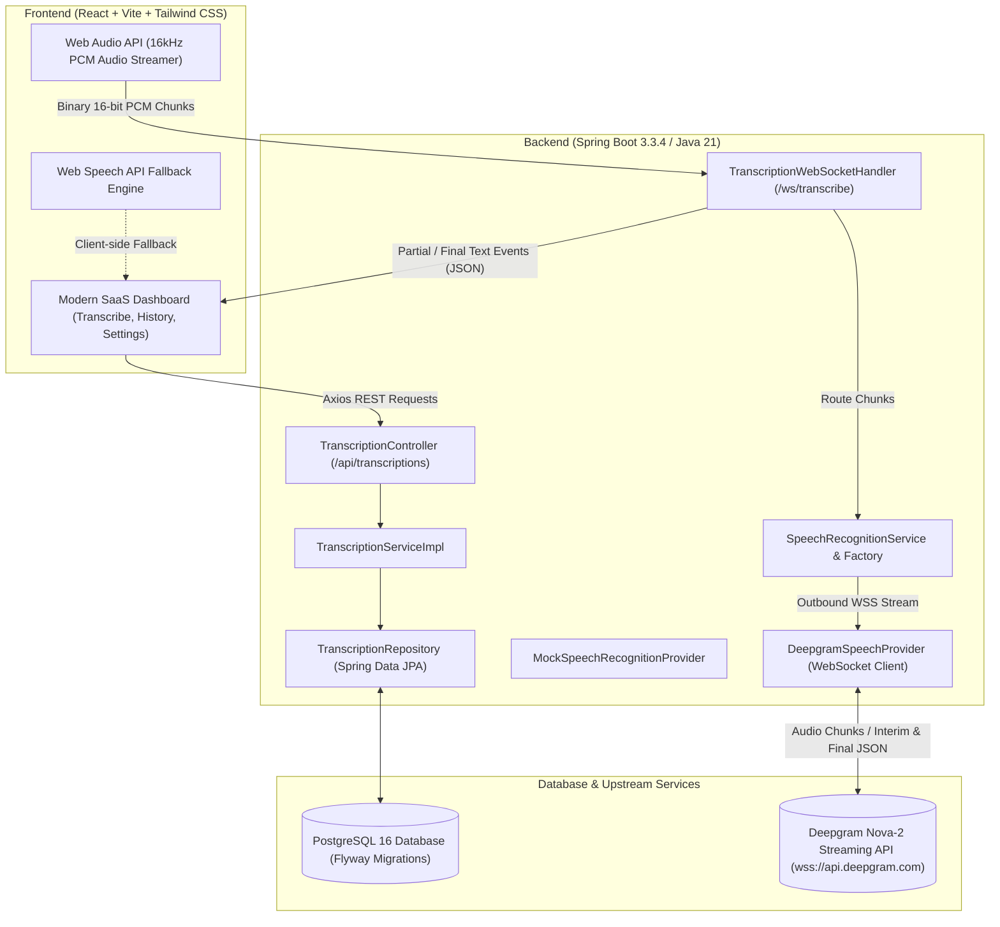

# Procucev AI — Real-Time Multilingual Speech-to-Text

> High-performance, production-ready speech-to-text web application supporting real-time incremental streaming, Hinglish (Hindi-English) code-switching, provisional vs finalized transcription tracking, and persistent transcription management.

---

## 1. Project Overview & Features

**Procucev AI Speech to Text** converts spoken speech into text in near real-time. It is designed to solve one of the hardest challenges in contemporary voice interfaces: **multilingual code-switching**, particularly the natural blending of Hindi and English words commonly used across South Asia (e.g., *"Hello everyone, आज हम अपने project का progress discuss करेंगे"*).

### Key Features
- **Real-Time Streaming Speech Recognition**: Captures raw 16kHz linear PCM audio chunks directly from the browser's Web Audio API and streams them over a persistent bidirectional WebSocket connection.
- **Accurate Code-Switching (Hindi + English)**: Handles seamless transitions between English and Hindi (Devanagari) within the same sentence.
- **Provisional Partial vs Finalized Distinction**: Live provisional text is displayed in a soft highlighted state that continuously updates without creating duplicate entries. Once speech finishes or pauses, finalized segments are permanently appended exactly once.
- **Provider Abstraction Layer**: Built with a modular plug-and-play architecture supporting:
  - **Deepgram Nova-2** (Default production streaming provider via backend WebSocket proxy)
  - **Mock Hinglish Engine** (Offline test simulator for deterministic unit/integration testing)
  - **Browser Web Speech API** (Client-native zero-dependency fallback for instant prototyping)
  - Pluggable extension points for **Google Gemini Live** or self-hosted **Whisper streaming**.
- **Backend Credential Security**: Third-party API credentials (`DEEPGRAM_API_KEY`) reside exclusively on the Spring Boot backend; no credentials are ever exposed to the client.
- **Full History & Transcript Management**:
  - Full CRUD operations backed by PostgreSQL and managed by Flyway migrations.
  - Search by title or transcript content.
  - Sort by newest/oldest and server-side pagination.
  - In-place editing of transcript title and content.
  - Export to `.txt` and copy-to-clipboard actions with instant toast feedback.
  - Safe deletion with modal confirmation.
- **Enterprise-Grade Architecture**: Java 21, Spring Boot 3.3.4, Hibernate/JPA, Flyway, PostgreSQL, React 18, Vite, Tailwind CSS, Lucide icons, Docker, and Docker Compose.

---

## 2. Architecture Diagram



---

## 3. Technology Stack

### Frontend
- **Framework**: React 18.3.1 (with Vite 5.4.10)
- **Language**: JavaScript (ES2022)
- **Styling**: Tailwind CSS 3.4.14 with customized glassmorphism and animations
- **Routing**: React Router DOM 6.28.0
- **HTTP Client**: Axios 1.7.7
- **Icons**: Lucide React 0.454.0

### Backend
- **Runtime**: OpenJDK 21 (Java 21 LTS)
- **Framework**: Spring Boot 3.3.4
- **Modules**:
  - `spring-boot-starter-web`: RESTful APIs and Global Exception Handling
  - `spring-boot-starter-websocket`: WebSocket endpoints for low-latency audio chunk streaming
  - `spring-boot-starter-data-jpa`: Persistence via Hibernate ORM
  - `spring-boot-starter-validation`: Bean validation (`@Valid`, `@NotBlank`, size limits)
  - `spring-boot-starter-actuator`: Health check (`/actuator/health`) and metrics
- **WebSocket Client**: `org.java-websocket:Java-WebSocket:1.5.7`
- **Database Driver**: `org.postgresql:postgresql:42.7.4`
- **Database Migration**: `org.flywaydb:flyway-core` & `flyway-database-postgresql`
- **Testing Engine**: JUnit 5, Mockito, MockMvc, AssertJ, and H2 (PostgreSQL compatibility mode)

### Database
- **Engine**: PostgreSQL 16
- **Migrations**: Flyway (`V1__init_transcriptions_table.sql`)

---

## 4. Database Schema

The database schema is versioned via Flyway:

```sql
CREATE TABLE IF NOT EXISTS transcriptions (
    id BIGSERIAL PRIMARY KEY,
    title VARCHAR(255) NOT NULL,
    content TEXT NOT NULL,
    language VARCHAR(50) DEFAULT 'hi-IN,en-US',
    duration_seconds INTEGER DEFAULT 0,
    created_at TIMESTAMP WITH TIME ZONE NOT NULL DEFAULT CURRENT_TIMESTAMP,
    updated_at TIMESTAMP WITH TIME ZONE NOT NULL DEFAULT CURRENT_TIMESTAMP
);

CREATE INDEX IF NOT EXISTS idx_transcriptions_created_at ON transcriptions (created_at DESC);
CREATE INDEX IF NOT EXISTS idx_transcriptions_title ON transcriptions (title);
```

---

## 5. REST API Documentation

Base URL: `http://localhost:8080/api/transcriptions`

### 1. Create a Transcription
- **Method**: `POST`
- **Path**: `/api/transcriptions`
- **Request Body**:
```json
{
  "title": "Weekly Sprint Standup",
  "content": "Hello everyone, आज हम अपने project का progress discuss करेंगे.",
  "language": "hi-IN,en-US",
  "durationSeconds": 45
}
```
- **Response (201 Created)**:
```json
{
  "id": 1,
  "title": "Weekly Sprint Standup",
  "content": "Hello everyone, आज हम अपने project का progress discuss करेंगे.",
  "preview": "Hello everyone, आज हम अपने project का progress discuss करेंगे.",
  "language": "hi-IN,en-US",
  "durationSeconds": 45,
  "wordCount": 9,
  "createdAt": "2026-10-27T12:00:00Z",
  "updatedAt": "2026-10-27T12:00:00Z"
}
```

### 2. List Transcriptions (with Pagination & Search)
- **Method**: `GET`
- **Path**: `/api/transcriptions?query=progress&page=0&size=10&sort=desc`
- **Response (200 OK)**:
```json
{
  "content": [
    {
      "id": 1,
      "title": "Weekly Sprint Standup",
      "content": "Hello everyone, आज हम अपने project का progress discuss करेंगे.",
      "preview": "Hello everyone, आज हम अपने project का progress discuss करेंगे.",
      "language": "hi-IN,en-US",
      "durationSeconds": 45,
      "wordCount": 9,
      "createdAt": "2026-10-27T12:00:00Z",
      "updatedAt": "2026-10-27T12:00:00Z"
    }
  ],
  "pageNumber": 0,
  "pageSize": 10,
  "totalElements": 1,
  "totalPages": 1,
  "last": true,
  "first": true,
  "empty": false
}
```

### 3. Fetch Single Transcription
- **Method**: `GET`
- **Path**: `/api/transcriptions/{id}`
- **Response (200 OK)**: Single transcript object.

### 4. Update Transcription
- **Method**: `PUT`
- **Path**: `/api/transcriptions/{id}`
- **Request Body**:
```json
{
  "title": "Updated Standup Title",
  "content": "Updated transcript text",
  "language": "hi-IN,en-US",
  "durationSeconds": 50
}
```
- **Response (200 OK)**: Updated transcript object.

### 5. Delete Transcription
- **Method**: `DELETE`
- **Path**: `/api/transcriptions/{id}`
- **Response**: `204 No Content`

### 6. Health Endpoint
- **Method**: `GET`
- **Path**: `/actuator/health`
- **Response (200 OK)**:
```json
{
  "status": "UP"
}
```

---

## 6. Real-Time WebSocket Streaming Protocol

- **Endpoint**: `ws://localhost:8080/ws/transcribe`

### Protocol Flow:
1. **Client connects** to `/ws/transcribe`.
2. **Client sends Start Message (JSON)**:
```json
{
  "action": "start",
  "provider": "deepgram",
  "language": "hi",
  "model": "nova-2"
}
```
3. **Client streams raw audio chunks**:
   - Format: 16,000 Hz, 1-channel (mono), 16-bit signed linear PCM (`Int16Array`).
   - Transmitted as binary WebSocket frames.
4. **Server dispatches incremental transcription events (JSON)**:
   - Partial / Provisional text (replaces preview):
     ```json
     { "type": "PARTIAL", "text": "Hello everyone आज" }
     ```
   - Finalized text (appended exactly once):
     ```json
     { "type": "FINAL", "text": "Hello everyone, आज हम अपने project का progress discuss करेंगे.", "language": "hi-IN", "confidence": 0.98 }
     ```
5. **Client sends Stop Message (JSON)**:
```json
{ "action": "stop" }
```

---

## 7. Prerequisites & Environment Setup

### Prerequisites
- **Java**: JDK 21+
- **Maven**: 3.9+
- **Node.js**: v20+ or v24+
- **PostgreSQL**: 15+ (or Docker)

### Environment Variables (.env)
Copy `.env.example` to `.env`:
```bash
cp .env.example .env
```

| Variable | Description | Default |
|---|---|---|
| `SPRING_DATASOURCE_URL` | PostgreSQL connection URL | `jdbc:postgresql://localhost:5432/speech_to_text` |
| `DB_USER` | PostgreSQL username | `postgres` |
| `DB_PASSWORD` | PostgreSQL password | `postgres` |
| `SPEECH_PROVIDER` | Default STT provider (`deepgram` or `mock`) | `deepgram` |
| `DEEPGRAM_API_KEY` | Deepgram API key (for live streaming) | Optional (mock / browser engine available) |
| `DEEPGRAM_MODEL` | Deepgram model | `nova-2` |
| `DEEPGRAM_LANGUAGE` | Deepgram language | `hi` (Hindi + English) |
| `CORS_ALLOWED_ORIGINS` | Permitted frontend origins | `http://localhost:5173,http://localhost:3000` |

---

## 8. Local Setup Instructions

### Option A: Running with Docker Compose (Recommended)
Make sure Docker Desktop is running, then execute:

```bash
docker-compose up --build
```
- Frontend: `http://localhost:5173`
- Backend API: `http://localhost:8080`
- PostgreSQL: `localhost:5432`

---

### Option B: Running Locally (Bare Metal)

#### 1. Start PostgreSQL
Ensure PostgreSQL is running locally and create the database:
```sql
CREATE DATABASE speech_to_text;
```

#### 2. Run Backend
```bash
cd backend
mvn spring-boot:run
```
Flyway will automatically apply migrations upon startup.
The backend will run on `http://localhost:8080`.

#### 3. Run Backend Automated Tests
```bash
cd backend
mvn test
```
All 19 automated tests (Service unit tests, MockMvc controller tests, Flyway migrations, and Speech provider tests) execute with 100% pass rate.

#### 4. Run Frontend
```bash
cd frontend
npm install
npm run dev
```
Open `http://localhost:5173` in your browser.

---

## 9. Speech Provider Setup Guide

### 1. Deepgram Nova-2 (Production Real-Time STT)
1. Register for a free account at [console.deepgram.com](https://console.deepgram.com) ($200 free credit).
2. Create an API Key.
3. Add it to `.env` or set as an environment variable:
   ```bash
   DEEPGRAM_API_KEY=your_actual_api_key_here
   ```
4. Start/Restart the backend. In the frontend Transcribe view, select **Deepgram Nova-2**.

### 2. Mock Engine (Offline Multilingual Simulator)
- Does not require any external internet access or credentials.
- In the frontend Transcribe view or Settings, select **Mock Engine**.
- As you speak or stream audio, it emits realistic Hinglish partial and finalized segments matching the hiring assignment prompt!

### 3. Browser-Native Web Speech API (Free / Zero Setup)
- Works immediately in Google Chrome or Microsoft Edge.
- Select **Browser Web Speech** in the Transcribe view.
- Provides zero-latency speech recognition with Hindi / English code-switching.

---

## 10. Automated Testing Verification

The backend includes a comprehensive automated test suite:
- `TranscriptionServiceImplTest`: Verifies business logic, repository interactions, search filtering, pagination, and not-found exception throwing.
- `TranscriptionControllerTest`: MockMvc tests validating status codes (201, 200, 400, 404, 204) and JSON request/response schema.
- `SpeechProviderTest`: Validates mock partial/final event dispatching, provider factory resolution, and missing API key error handling.
- `SpeechToTextApplicationTests`: End-to-end Spring context bootstrap with Flyway schema migration validation on H2 PostgreSQL dialect.

Run tests:
```bash
cd backend
mvn test
```

---

## 11. Cloud Deployment Guide

### Frontend Deployment (Vercel)
1. Push the code to GitHub.
2. Connect your repository to [Vercel](https://vercel.com).
3. Set the Root Directory to `frontend`.
4. Add Environment Variable:
   - `VITE_BACKEND_URL`: URL of your deployed Spring Boot backend (e.g. `https://api.yourdomain.com`).
5. Deploy.

### Backend Deployment (Render / Railway / AWS / GCP)
1. Use the provided multi-stage `backend/Dockerfile`.
2. Connect a managed PostgreSQL database instance (Neon, Supabase, or AWS RDS).
3. Configure environment variables in the host dashboard:
   - `SPRING_DATASOURCE_URL`: `jdbc:postgresql://<host>:<port>/<dbname>`
   - `DB_USER`: `<username>`
   - `DB_PASSWORD`: `<password>`
   - `DEEPGRAM_API_KEY`: `<your_deepgram_key>`
   - `CORS_ALLOWED_ORIGINS`: `https://your-frontend.vercel.app`
4. Deploy the container. The backend exposes health check at `/actuator/health` for uptime monitors.

---

## 12. Security & Known Limitations

- **Authentication Limitations**: The current MVP focuses on high-performance transcription and team workspace management without an individual user account login layer. Multi-tenant access controls can be added by integrating Spring Security OAuth2 / JWT.
- **Microphone Permissions**: Browser security policies require HTTPS (or `localhost`) for microphone access via `navigator.mediaDevices.getUserMedia`.
- **WebSocket Streaming Timeouts**: Certain cloud reverse proxies (like Cloudflare or basic AWS ALB) have a default 60-second idle WebSocket timeout. The client sends lightweight ping heartbeats to maintain active connection streams during extended speech sessions.
